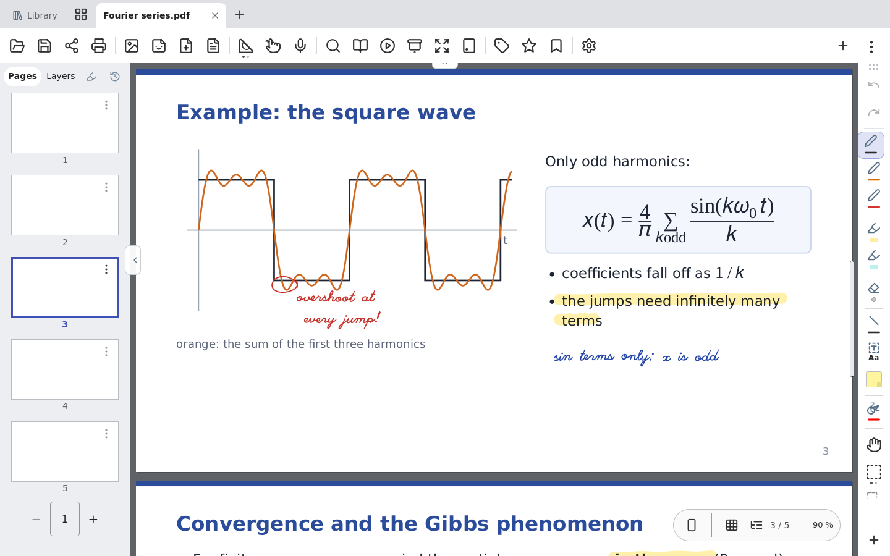
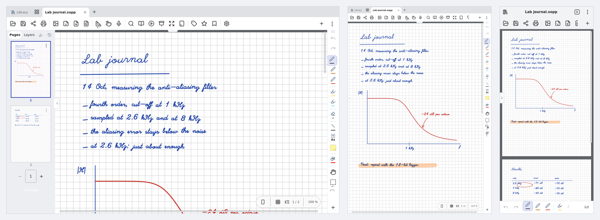
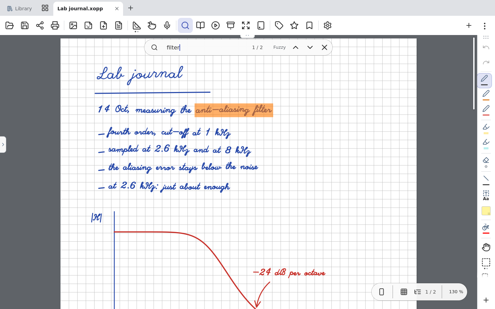
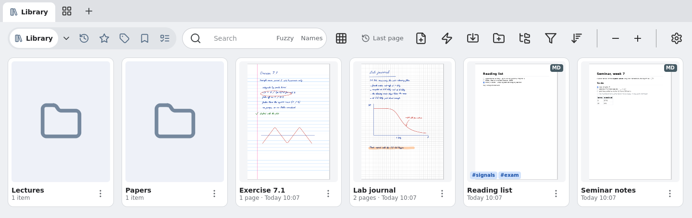
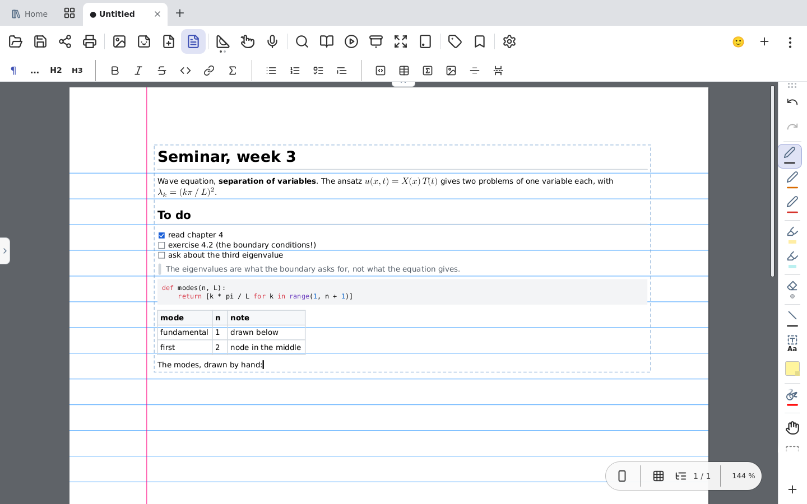
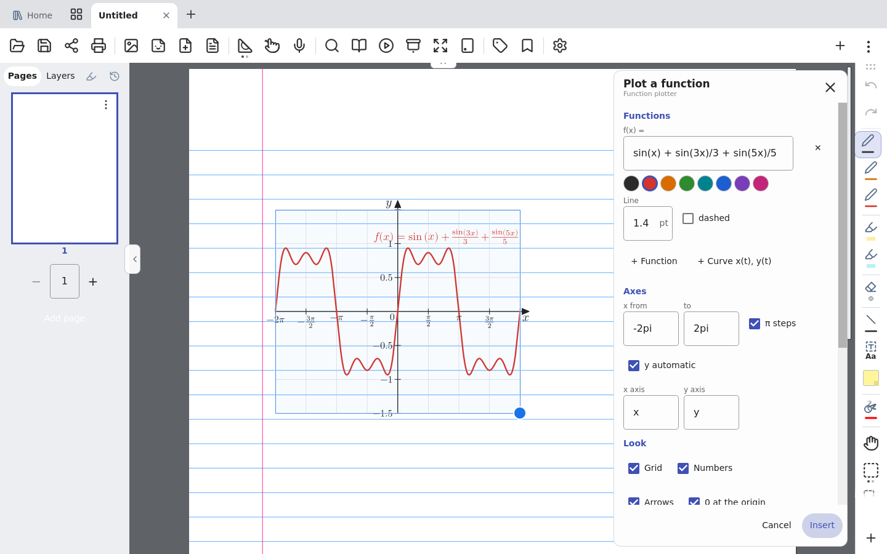

# xournal-qt

**Write on your PDFs with a pen — and keep them yours.** Handwritten notes, PDF annotation and Markdown in one free
app for Linux, Windows, macOS and Android, from a desktop to a pen tablet to a phone. Your handwriting is searchable,
your notes stay in ordinary PDF files, and nothing needs an account or a cloud. A Qt 6 fork of
[Xournal++](https://github.com/xournalpp/xournalpp).

<br clear="left">

<!-- xournal-qt: the fork's part of this README ends at "Everything below is the README of upstream Xournal++"
     (a seam: qt/docs/decisions/0002-upstream-seams.md) -->
> **Developers:** the docs start at [qt/docs/README.md](qt/docs/README.md) (the repository's layout, building,
> testing, the features, the decisions); agents read [AGENTS.md](AGENTS.md) first.



> **Status:** alpha (0.13). Every release runs the full test suite on Linux and smoke tests of its packages on every
> platform, but a lot has only been tried on a few devices so far: expect rough edges, and see the "Known limits" of
> the [latest release](https://github.com/R-Fehler/xournal-qt/releases).

## Why

Lecture slides, papers, contracts, textbooks, your own notes: most knowledge work today happens on documents, and a
pen is still the best way to think on them. Yet the notes we write on our devices mostly end up locked away — in an
app's private library, behind a subscription, synced only through its maker's cloud, readable only on the platforms it
chose to support. On Linux and Android there is hardly anything that takes a pen seriously at all.

[Xournal++](https://github.com/xournalpp/xournalpp) has been the free answer for a decade: open files and a drawing
core that feels right under a pen, built by volunteers. xournal-qt keeps that core unchanged — its documents *are*
Xournal++ documents — and builds a new, touch-first interface around it, with what it takes to live in it every day,
on every device. Your notes should outlive the app you wrote them with.

## Your notes are PDFs

- **A document is a PDF.** Write on a lecture's slides or a paper and save: the ink goes into the PDF itself as
  standard annotations, drawn exactly as you see it. Every PDF viewer shows it — a browser, Preview, Acrobat, Okular,
  the viewer on your phone — so you can send the file to anyone.
- **The editable original travels inside.** Every stroke stays editable: the full notes (layers, Markdown, recordings,
  page backgrounds) are embedded in the same PDF, and open here again with nothing flattened.
- **Your handwriting is in the PDF's text, too.** What the handwriting search reads goes into an invisible text layer,
  so other PDF apps find and select the words you wrote by hand.
- **Versions, passwords, archives.** Earlier versions are kept inside the PDF and can be compared side by side;
  PDFs can be protected with a password; "Export for the archive" writes PDF/A-3b, checked with veraPDF.
- **Notes from other apps become yours.** Ink, highlights, text boxes and sticky notes that GoodNotes, Drawboard or
  Preview wrote into a PDF open as editable strokes and boxes here.
- **No lock-in anywhere.** Documents are files in your own folders (PDF, `.xopp`, `.md`); a library is just a folder,
  synced with whatever you already use. Prefer Xournal++'s own format? Pick "Xournal++ files" at the first start, and
  a `.xopp` written here opens in Xournal++ and the other way round.

## Every screen, every input



- **One interface that lays itself out** for a wide desktop, an upright 2-in-1 or Surface, a foldable, and a phone
  (a top bar, a tool dock within thumb reach, sheets instead of menus).
- **Pen, finger and mouse are told apart.** The pen writes with your hand resting on the screen; a finger scrolls,
  zooms and turns the canvas. Hold the pen still to straighten a line, scratch out to erase.
- **Your own toolbox.** The pens, highlighters, shapes and erasers you use sit on a rail beside the page, in your
  order and your colors; drag them, group them, carry them to the top bar. **Zen** hides everything but the page.
- **Tabs, an overview and a reference view.** Several documents at once, a grid of all of them and their pages, and
  a second document (or the same one) beside the one you write in.

## Find anything, even what you wrote by hand



- **Handwriting search** reads your notes in the background with a model built into the app (English and German),
  on your device: no download, no cloud. Ctrl+F marks the words on the ink, and handwriting can be copied as text.
- **Search on three levels:** this document, all open documents, or the whole library, including the text of PDFs
  you have not opened in months. Hits are shown on the pages; fuzzy search if you want it.
- **A library that is just folders.** Point it at any folder: covers, favourites, page bookmarks, `#tags`, to-dos
  collected from all your notes, links between documents. Nothing is imported or moved; share a folder as one zip.



## Markdown on the page



Write Markdown on a page or a sticky note and see it formatted as you type: formulas (`$…$`, no LaTeX installation
needed), pictures, tables, highlighted code and check lists, with a formatting bar for those who do not know the
syntax. Plain `.md` files open as documents of their own, and a text document can be kept as a PDF that carries its
Markdown source.

## Teaching, presenting, studying

- **Present on a second screen:** the projector shows only the slide; your laptop shows it with your tools and a
  timer, and you can zoom in to write while the audience keeps the whole slide. A laser pointer, a **curtain** that
  uncovers a calculation step by step, and a **spotlight**.
- **Space for notes beside slides**, page templates, and **stickers**: your own, and built-in ones for circuits,
  logic gates, 3D solids and lab glassware.
- **Recordings tied to your notes:** record a lecture while you write, then play it from any stroke to hear what was
  said as you wrote it.
  **Replay** shows how a page was written, with its recordings, on a play bar.
- **Sticky notes** that hold ink, text and pictures and can cover an answer for self-testing; Scholar and arXiv
  lookups for a selected reference (network use is opt-in, and every address is shown first).
- **Plugins in JavaScript**, each in a sandbox, with a **function plotter** built in: type a function, see it on the
  page, insert it as ink with its formula as a label.



## Compared with other note apps

|  | xournal-qt | Xournal++ | GoodNotes | Drawboard PDF |
| --- | --- | --- | --- | --- |
| Notes on a PDF | **saved in the PDF** (standard annotations, editable original inside) | a `.xopp` beside the PDF; export as a new PDF | imported into the app; export as a new PDF | saved in the PDF |
| Platforms | Linux, Windows, macOS, Android; iOS planned | Linux, Windows, macOS | iPad, iPhone, Mac; Windows and Android versions | Windows |
| Price, license | free, GPL | free, GPL | free tier, then paid | free tier, then subscription |
| Where your notes live | files in your folders (`.xopp`, PDF, `.md`) | files | the app's own library | PDF files |
| Sync | any folder sync (Nextcloud, Syncthing, OneDrive, …) | any | iCloud | cloud storage of your choice |
| Adapts to phone and tablet | yes | desktop layout | yes | tablet and desktop |
| Typed text | live Markdown with formulas, on the page | text boxes, LaTeX tool | text boxes | text annotations |
| Search | all your documents: PDF text and **handwriting**, on the device | the open document | all notebooks, handwriting too | PDF text |

Where others are ahead: GoodNotes is the more polished iPad app (there is no iOS version here yet); Drawboard PDF has
more PDF markup tools (stamps, measurements). Xournal++'s LaTeX tool is not carried over (formulas are written in
Markdown instead), and its Lua plugins do not run here (porting one to JavaScript is mostly mechanical).

## Getting it

Download from the [releases](https://github.com/R-Fehler/xournal-qt/releases):

| System | File |
| --- | --- |
| Debian 13 | `xournal-qt_<version>_amd64_debian13.deb` |
| Ubuntu 26.04, Kubuntu 26.04 | `xournal-qt_<version>_amd64_ubuntu26.04.deb` |
| Any Linux from Ubuntu 22.04 on (KDE neon, Ubuntu 24.04, Fedora, …) | `xournal-qt-<version>-x86_64.AppImage` (carries its own Qt) |
| Windows 10 and 11 | `xournal-qt-<version>-windows-setup-x64.exe` (no administrator rights needed; the next version's installer updates it in place), or the portable `…-windows-x64.zip` |
| macOS 15 or newer, Apple Silicon | `xournal-qt-<version>-macos-arm64.dmg` (not signed yet: [how to open it](qt/docs/development/macos.md)) |
| Android 9 or newer (64-bit ARM) | `xournal-qt-<version>-android-arm64.apk` |

Which package fits which system: [qt/docs/development/releasing.md](qt/docs/development/releasing.md#which-package-for-which-system).
From source (Linux, Qt 6.5 or newer):

```sh
qt/scripts/linux-deps.sh                                          # Debian / Ubuntu: what the build needs
cmake -S qt -B build-qt -G Ninja -DCMAKE_BUILD_TYPE=RelWithDebInfo
cmake --build build-qt
./build-qt/xournal-qt
```

More: [the developer docs](qt/docs/README.md) · [the features](qt/docs/features/README.md) ·
[how it came to be](qt/docs/history/README.md) · [Android](qt/docs/development/android.md) ·
[Windows](qt/docs/development/windows.md) · [macOS](qt/docs/development/macos.md) ·
[how the fork is kept](FORK.md) · [how these pictures are made](qt/docs/screenshots/README.md)

---

*Everything below is the README of upstream Xournal++, whose core this fork builds on.*

#   <br> Xournal++


[](https://dev.azure.com/xournalpp/xournalpp/_build/latest?definitionId=1&branchName=master)


## Translations

Would you like to see Xournal++ in your own language? Translators are welcome to contribute to Xournal++.

You can contribute translations on [Crowdin](https://crowdin.com/project/xournalpp/).

Interested in translating a new language? Discuss on [Matrix](https://matrix.to/#/#xournalpp_xournalpp:gitter.im) or create a [new issue](https://github.com/xournalpp/xournalpp/issues) to unlock the language on Crowdin.

**Thanks in advance!**

## Features

Xournal++ (/ˌzɚnl̟ˌplʌsˈplʌs/) is a hand note-taking software written in C++ with the target of flexibility, functionality and speed.
Stroke recognizer and other parts are based on Xournal Code, which you can find at [SourceForge](http://sourceforge.net/projects/xournal/).

Xournal++ features:

- Supports pressure-sensitive styluses and digital pen tables (e.g. Wacom, Huion, XP Pen, etc. tablets)
- Paper backgrounds for note-taking, scratch paper, or whiteboarding
- Annotate on top of PDFs
- Select text from the background PDF, copy, highlight or underline it or strike it through
- Follow links from the background PDF
- Export to a variety of formats including SVG, PNG and PDF, both from the GUI and command line
- Different drawing tools (e.g. pen, highlighter) and stroke styles (e.g. solid, dotted)
- Shape drawing (line, arrow, circle, rectangle, spline)
- Use the set-square and compass tools for measurements or as a guide for drawing straight lines, circular arcs and radii
- Fill shape functionality
- Shape resizing and rotation
- Rotation and grid snapping for precise alignment of objects
- Input stabilization for smoother writing/drawing
- Text tool for adding text in different fonts, colors, and sizes
- Enhanced support for image insertion
- Eraser with multiple configurations
- LaTeX support (requires a working LaTeX installation) with customizable template and a resizable editor with syntax highlighting
- Sidebar containing page previews with advanced page sorting, PDF bookmarks and layers (can be individually hidden/edited)
- Allows mapping different tools/colors etc. to stylus/mouse buttons
- Customizable toolbar with multiple configurations, e.g. to optimize toolbar for portrait/landscape
- Custom color palette support using the .gpl format
- Page template definitions
- Bug reporting, auto-save, and auto backup tools
- Audio recording and playback alongside with handwritten notes
- Multi language support (over 20 languages supported)
- Plugins using Lua scripting


<table>
<tr>
<td>

## GNU/Linux


</td><td>

## Windows 10


</td></tr><tr><td>

## macOS Catalina


</td><td>

## Xournal++ Mobile on Chromium OS


</td></tr><tr><td>

## Toolbar / Page Background / Layer

Multiple page background, easy selectable on the toolbar


</td><td>

## Layer sidebar and advanced layer selection


</td></tr><tr><td>

## Multiple predefined and fully customizable toolbars


</td></tr></table>

## User Guide

Check out the [website](https://xournalpp.github.io/guide/overview/) for a detailed user guide.

## Installing

The official releases of Xournal++ can be found on the
[Releases](https://github.com/xournalpp/xournalpp/releases) page. We provide
binaries for Debian, Ubuntu, macOS and Windows.
For other GNU/Linux distributions (or older/newer ones), we also provide an
AppImage that is binary compatible with any distribution released around or
after Ubuntu 22.04. For installing Xournal++ Mobile on handheld devices, please check out the [Mobile & web app section](#mobile--web-app)

**A note for Ubuntu/Debian users**: The official binaries that we provide are
only compatible with the _specific version of Debian or Ubuntu_ indicated by the
file name. For example, if you are on Ubuntu 20.04, the binary whose name
contains `Ubuntu-bionic` is _only_ compatible with Ubuntu 18.04. If your system
is not one of the specific Debian or Ubuntu versions that are supported by the
official binaries, we recommend you use either the PPA (Ubuntu only), the Flatpak, or the
AppImage.

There is also an _unstable_, [automated nightly
release](https://github.com/xournalpp/xournalpp/releases/tag/nightly) that
includes the very latest features and bug fixes.

With the help of the community, Xournal++ is also available on official repositories
of some popular GNU/Linux distros and platforms.

[](https://repology.org/project/xournalpp/versions)


### Debian

On Debian bookworm and Debian sid the `xournalpp` package (stable version) is contained in the official repositories. Simply install via

```sh
sudo apt install xournalpp
```

There are also the official [Stable releases](https://github.com/xournalpp/xournalpp/releases) and
_unstable_ [automated nightly releases](https://github.com/xournalpp/xournalpp/releases/tag/nightly).

### Ubuntu and derivatives

On distros based on Ubuntu 22.04 Jammy Jellyfish (and later) the `xournalpp` package (stable version) is contained in the official repositories.
Simply install via

```sh
sudo apt install xournalpp
```

#### Stable PPA
The latest stable version is available via the following [_unofficial_ PPA](https://github.com/xournalpp/xournalpp/issues/1013#issuecomment-692656810):

```sh
sudo add-apt-repository ppa:apandada1/xournalpp-stable
sudo apt update
sudo apt install xournalpp
```

#### Unstable PPA
An _unstable_, nightly release is available for Ubuntu-based distributions via the following PPA:

```sh
sudo add-apt-repository ppa:andreasbutti/xournalpp-master
sudo apt update
sudo apt install xournalpp
```

This PPA is provided by the Xournal++ team. While it has the latest features and
bug fixes, it has also not been tested thoroughly and may break periodically (we
try our best not to break things, though).

### Fedora

The [released version of
xournalpp](https://src.fedoraproject.org/rpms/xournalpp) is available in the
[main repository](https://bodhi.fedoraproject.org/updates/?packages=xournalpp)
via _Software_ application or the following command:

```sh
sudo dnf install xournalpp
```

or

```sh
pkcon install xournalpp
```

The bleeding edge packages synced to xournalpp git master on a daily basis are available from [COPR luya/xournalpp](https://copr.fedorainfracloud.org/coprs/luya/xournalpp/).
[](https://copr.fedorainfracloud.org/coprs/luya/xournalpp/package/xournalpp/)

### openSUSE

On openSUSE Tumbleweed, the released version of Xournal++ is available from the
main repository:

```sh
sudo zypper in xournalpp
```

For openSUSE Leap 15.0 and earlier, use the install link from
[X11:Utilities](https://software.opensuse.org//download.html?project=X11%3AUtilities&package=xournalpp).

For all versions of openSUSE, bleeding edge packages synced to xournalpp git
master on a weekly basis are available from
[home:badshah400:Staging](https://software.opensuse.org//download.html?project=home%3Abadshah400%3AStaging&package=xournalpp).

### Arch Linux

The latest stable release is available [in the [extra]
repository](https://www.archlinux.org/packages/extra/x86_64/xournalpp/).

To build the latest state of the master branch yourself, use [this AUR
package](https://aur.archlinux.org/packages/xournalpp-git/).

### Solus

The latest stable release is available in the main repository:

```sh
sudo eopkg it xournalpp
```


### Chrome OS

You can [enable the linux container](https://support.google.com/chromebook/answer/9145439?hl=en), and install the [Debian package](https://github.com/xournalpp/xournalpp?tab=readme-ov-file#debian) from the official Debian repositories.
```sh
sudo apt install xournalpp
```

### Flatpak

The Xournal++ team officially supports a [FlatHub
release](https://flathub.org/apps/details/com.github.xournalpp.xournalpp), which
can be installed with

```sh
flatpak install flathub com.github.xournalpp.xournalpp
```

Note that for Xournal++ to work properly, you must have at least one GTK theme
and one icon theme installed on Flatpak. To enable LaTeX support, you will also
need to install the TeX Live extension:

```sh
flatpak install flathub org.freedesktop.Sdk.Extension.texlive
```

The Flatpak manifest can be found at the [Xournal++ Flatpak packaging
repository](https://github.com/flathub/com.github.xournalpp.xournalpp), and all
Flatpak-related packaging issues should be reported there.

### Android

Android is supported by Xournal++ Mobile. It can be downloaded [from F-Droid](https://f-droid.org/en/packages/online.xournal.mobile/) or you can [build](#building-the-mobile-app) it.


### iOS

Unfortunately, the iOS app is not published yet in the Apple App Store. Read [this](#mobile--web-app) to learn, why. Anyway, in the [Building section](#building-the-mobile-app) you can learn how to build an early preview.

### Windows

Official Windows releases are provided on the [Releases
page](https://github.com/xournalpp/xournalpp/releases).

You can also download it from the Microsoft Store (supports automated updates):

<a href="https://apps.microsoft.com/detail/9nn1hhct0p1x?referrer=appbadge&mode=full" target="_blank"  rel="noopener noreferrer">
	
</a>

Our official GitHub release is also available via [winget](https://github.com/microsoft/winget-pkgs/tree/master/manifests/x/Xournal%2B%2B/Xournal%2B%2B). Open PowerShell and run:

```sh
winget install -e --id Xournal++.Xournal++
```

You can also install it via [Scoop](https://scoop.sh/):

```sh
scoop bucket add extras
scoop install extras/xournalpp
```
You can easily update Xournal++ with winget or scoop.


### macOS

Releases for macOS are provided on the [Releases
page](https://github.com/xournalpp/xournalpp/releases).
However, the app will refuse to run due to Apple policies (see https://github.com/xournalpp/xournalpp/issues/6185). Run the following commands one by one to make it work:
```
xattr -c /Applications/Xournal++.app
codesign --force --deep --sign - /Applications/Xournal++.app
```
And for those who type it out, don't forget to type the hyphen (`-`) between `--sign` and `/Applications/Xournal++.app`

## Building

We support building on three operating systems:

- [Linux](readme/LinuxBuild.md)
- [macOS](readme/MacBuild.md)
- [Windows](readme/WindowsBuild.md)
- [Windows on ARM (not officially supported)](readme/WindowsBuildArm.md)


## File format

The file extension `.xopp` is a gzipped XML file. PDFs are not embedded into the file, so if the PDF is deleted, the background is lost. `.xopp` is basically the same file format as `.xoj`, which is used by Xournal. Therefore, Xournal++ is able to read `.xoj` files, and can also export to `.xoj`. As soon as notes are exported to a `.xoj` file, all Xournal++ specific extensions like additional background types, are lost.

`.xopp` files can theoretically be read by Xournal, as long as you do not use any new features. Xournal does not open files that contain new attributes or unknown values, so Xournal++ will add the extension `.xopp` to all saved files to indicate the potential presence of Xournal++-only features.

All new files will be saved as `.xopp`. If an `.xoj` file that was created by Xournal is opened, the Save-As dialog will be displayed on save. If the `.xoj` file was created by Xournal++, the file will be overwritten on save and the file extension will not change.

**We are currently introducing a new file format that can efficiently store attached PDF files and other attachments internally. We will still allow for attachments that are linked to external files. Please refer to [#937](https://github.com/xournalpp/xournalpp/issues/937) for further details.**

## Mobile & web app

From mid 2020 to May 2021, a Flutter-written mobile app for **Android** and **iOS** (unreleased) and the **web**
has been developed, which supports the file format and most of the basic features of Xournal++.
Unfortunately development has stalled and we have lost contact to the (single) developer. The web app is no longer available.
You can still check out the [separate repository on GitLab](https://gitlab.com/TheOneWithTheBraid/xournalpp_mobile) or install it from [F-Droid](https://f-droid.org/en/packages/online.xournal.mobile/).

### Building the mobile app

- [Android Build](https://gitlab.com/TheOneWithTheBraid/xournalpp_mobile#getting-started)
- [iOS Build](https://gitlab.com/TheOneWithTheBraid/xournalpp_mobile#getting-started)

## Contributing

See [CONTRIBUTING.md](./CONTRIBUTING.md). If your pull request does not need Xournal++ to be built to test it (e.g. for a README update), you can prepend [skip ci] to the title of the commit to disable CI running.
